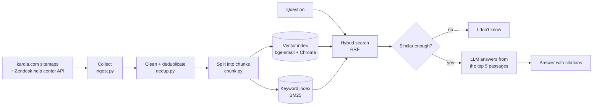

# Cardio Knowledge Assistant

A question-answering assistant over AliveCor's public heart-health content: the Kardia blog,
product pages and the AliveCor help center. It answers only from that content, cites the page
behind every answer, and says "I don't know" when the answer isn't there.

Built for the Nexlevr AI Knowledge Systems program (Advanced track).

## How it works



1. **Collect** (`src/ingest.py`). Blog, product and technology pages come from the kardia.com
   sitemaps; help center articles come from the public Zendesk API. Each run fetches only new or
   changed content: help articles are filtered by their `updated_at` date, web pages by a hash of
   their text. The crawler follows `robots.txt` and waits one second between pages.
2. **Clean and deduplicate** (`src/dedup.py`). Removes page template (menus, banners), drops
   legal pages and near-empty pages, and removes exact duplicates (same hash) and near duplicates
   (MinHash + LSH, Jaccard ≥ 0.8).
3. **Chunk** (`src/chunk.py`). Splits documents at headings and paragraphs into passages of up to
   ~300 words. Each passage is indexed together with its page title, so a short help-center
   answer like "No, these are not required" can still be found by its question.
4. **Index** (`src/index.py`). Builds two indexes: semantic (`BAAI/bge-small-en-v1.5`
   embeddings in Chroma) and keyword (BM25).
5. **Search** (`src/search.py`). Runs both searches and merges them with Reciprocal Rank Fusion,
   so a passage ranked well by both methods comes first.
6. **Answer** (`src/assistant.py`). A local LLM (`qwen2.5:7b` through Ollama) writes the answer
   using only the top 5 passages and cites them as [1], [2], ...

## Safety

Health questions need more care than a general chatbot, so the assistant has several layers:

| Situation | What happens |
|---|---|
| Off-topic question (similarity below 0.6) | "I don't know", without calling the LLM |
| On-topic, but the answer isn't in the passages | The LLM replies "I don't know" |
| Answer without a valid citation | Not shown; made-up citation numbers are removed |
| Request for personal medical advice | Redirects to a doctor, plus general information with citations |
| Severe symptoms happening now | Tells the user to call emergency services |

Everything runs locally by default, so health questions never leave the user's machine.

## Data

| Source | Documents collected |
|---|---|
| AliveCor help center (Zendesk API) | 233 |
| Kardia blog | 48 |
| Product and technology pages | 40 |

After cleaning: 316 documents, 563 passages.

## Design decisions

These came from looking at the data, not from the start:

- **Product pages looked like duplicates of each other.** Their main content is loaded by
  JavaScript, so the extracted text was mostly the site menu. Adding each page's meta description
  and removing template lines (lines repeated on many pages of the same kind) fixed it, instead
  of lowering the duplicate threshold.
- **The medical disclaimer is kept once.** "Kardia personal EKGs do not check for heart attack"
  appears on every page, so it was removed as template, but that would make the assistant unable
  to answer "Can Kardia detect a heart attack?". Long template lines are kept once, in a separate
  "site-wide notices" document.
- **Legal pages are dropped.** One terms-of-service page made up 7% of all passages and pulled
  unrelated searches toward contract text. It is detected by its title, since its URL doesn't
  show it.
- **Wrong page titles are fixed.** One blog article carried the blog's general title, which made
  it match almost any query. Its title is rebuilt from its URL.
- **Zendesk's `updated_at` also changes on metadata-only edits**, so a content hash decides
  whether an article really changed.

## Setup

Requires Python 3.11+ and [Ollama](https://ollama.com).

```bash
git clone https://github.com/alexandratelescu/cardio-knowledge-assistant.git
cd cardio-knowledge-assistant
python -m venv .venv
.venv\Scripts\activate          # Windows; on macOS/Linux: source .venv/bin/activate
pip install -r requirements.txt
ollama pull qwen2.5:7b
```

## Usage

Build the knowledge base (the first run takes a few minutes):

```bash
python update.py
```

Run the same command later to pull in AliveCor's new and changed content.

Start the web app:

```bash
streamlit run app.py
```

Or ask questions in the terminal:

```bash
python src/assistant.py        # full assistant
python src/search.py           # search results only, with scores
```

To use a hosted model instead of Ollama, set `LLM_BACKEND=groq` and `GROQ_API_KEY`.

## Evaluation

30 test questions (21 answerable, 4 out of scope, 3 asking for medical advice, 2 describing an
emergency), checked with `eval/evaluate.py`. Full results and discussion in
[`eval/report.md`](eval/report.md).

| | Accuracy |
|---|---|
| Retrieval, hybrid search (correct source in top 5) | 21/21 (100%) |
| Retrieval, vector search only | 15/21 (71%) |
| Retrieval, BM25 only | 14/21 (67%) |
| Answerable questions, correctly answered and cited | 20/21 (95%) |
| Questions that should be refused, handled correctly | 9/9 (100%) |

BM25 and vector search mostly fail on different questions, so combining them with RRF covers
both and reaches full retrieval accuracy on this set. All out-of-scope, medical-advice and
emergency questions were handled correctly.

## Limitations

- English only: the embedding model and the content are in English.
- Articles deleted from AliveCor's site are not removed from the knowledge base yet.
- Time-limited content, like a Black Friday banner, is kept until the next update.
- Product details that are loaded only by JavaScript are not collected.
- The evaluation set is small (30 questions) and grades answers by citation match rather than by
  reading every answer, so it can undercount a good answer that cites a different, also valid,
  source. See `eval/report.md` for a case like this.

## Disclaimer

This is a student project. It does not give medical advice. Always talk to a doctor about your
heart health. All content belongs to AliveCor, Inc.; this repository contains only code, and the
data is collected locally when you run it.